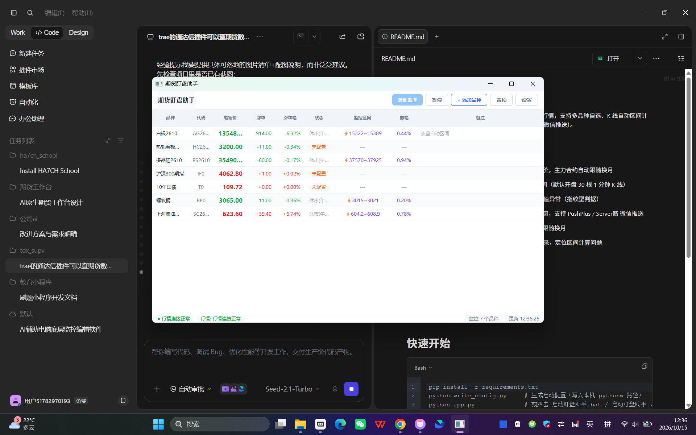
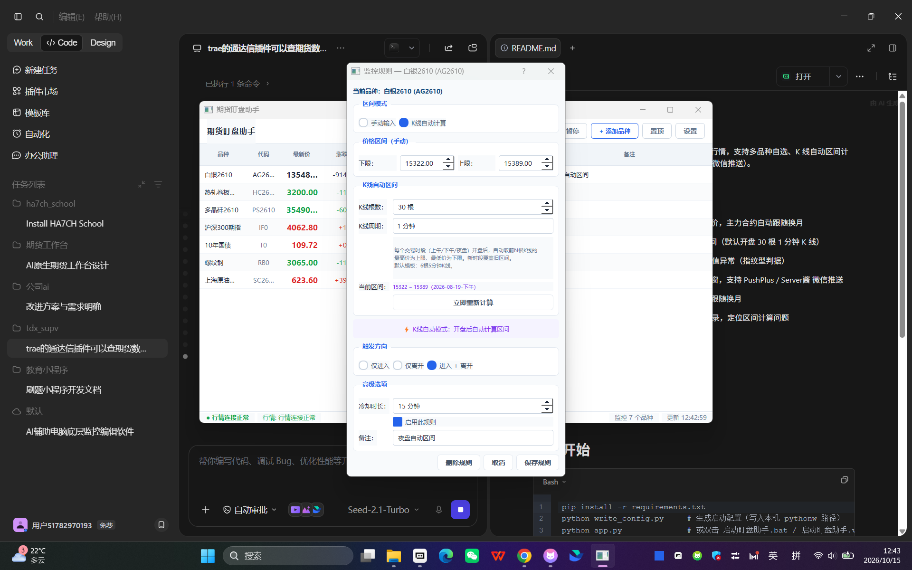
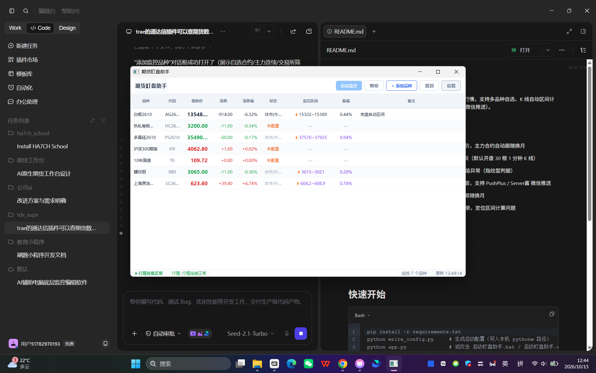
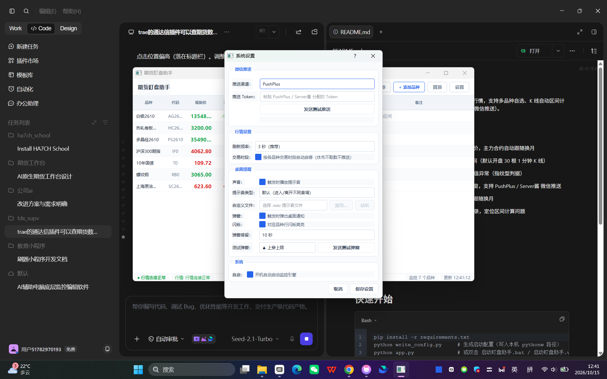

# 期货盯盘助手

国内期货价格区间监控桌面工具。基于新浪财经公开行情，支持多品种自选、K 线自动区间计算、集合竞价残留剔除、突破提醒（桌面动画弹窗 + 微信推送）。

## 功能特性

- 📊 **多品种行情监控** — 批量获取国内期货实时报价，主力合约自动跟随换月
- 🎯 **智能区间计算** — 支持手动区间 / K 线自动区间（默认开盘 30 根 1 分钟 K 线）
- 🧹 **集合竞价残留剔除** — 自动识别并修复 K 线极值异常（指纹型判据）
- 🔔 **突破提醒** — 价格穿越区间边界时桌面动画弹窗，支持 PushPlus / Server酱 微信推送
- 📌 **自选管理** — 置顶、振幅着色、主力合约自动跟随换月
- 🔧 **区间诊断** — 右键查看 K 线明细与异常修正记录，定位区间计算问题

## 界面预览

### 主界面 — 行情总览



主窗口集中展示所有自选品种的实时行情。每行显示品种名称、代码、最新价、涨跌、涨跌幅、状态、监控区间、振幅与备注。状态列通过颜色和箭头直观提示：「未配置」（灰色）、「正常」（蓝色区间内）、「触达上/下限」（红色箭头）、「休市半一」等。底部状态栏实时显示监控运行状态、行情连接正常与当前监控品种数。

### 规则编辑 — K 线自动区间



双击任意品种行即可打开监控规则配置。核心亮点是 **K 线自动区间** 模式：每个交易时段（上午 / 下午 / 夜盘）开盘后，自动取最近 N 根 1 分钟 K 线的最高价作为上限、最低价作为下限，新时段开始自动覆盖上一时段区间，无需手动盯盘重设。支持设置 K 线根数与周期、触发方向（仅进入 / 仅离开 / 进入+离开）、冷却时长与启用开关，同时可随时切换为手动输入固定上下限。

### 添加品种 — 合约自选



点击工具栏「+ 添加品种」打开品种选择对话框，支持三种筛选方式：
- **自选合约** — 直接输入代码（如 `RB2610`）查询
- **主力连续** — 按交易所分组快速浏览主力合约
- **交易所筛选** — 按中金所 / 上期所 / 大商所 / 郑商所 / 能源 / 广期所 / 上海国际等板块一键筛选

列表展示代码、名称、最新价、成交量、持仓量，选中后点击「加入监控」即可添加到主窗口。

### 系统设置 — 推送与提醒



系统设置对话框集中管理所有通知与运行参数：
- **微信推送** — 支持 PushPlus / Server酱，填入 Token 即可一键发送测试
- **行情设置** — 刷新间隔（默认 3 秒）、是否按品种交易时段自动收盘
- **桌面提醒** — 提示音（可选自定义 wav 文件）、弹窗高亮、行闪烁、弹窗停留时长
- **系统** — 开机自动启动监控引擎

## 环境要求

- Python 3.10+
- Windows 7 / 10 / 11
- 无账号、无 API Key（新浪财经公开行情）

## 快速开始

```bash
pip install -r requirements.txt
python write_config.py     # 生成启动配置（写入本机 pythonw 路径）
python app.py              # 或双击 启动盯盘助手.bat / 启动盯盘助手.vbs
```

## 数据说明

- **行情源**：新浪财经（`hq.sinajs.cn`），公开免 Key
- **用户数据**（自选 / 持仓 / 设置）：存储在 `~/.tdx_futures_monitor/config.db`，不上传仓库
- **推送 Token**（PushPlus / Server酱）：存储在本地 config.db，不进源码

## 打包 exe

```bash
pip install pyinstaller
pyinstaller tdx_monitor.spec
```

产物：`dist/tdx_monitor.exe`

## 免责声明

本工具仅供学习交流，不构成任何投资建议。期货交易有风险，使用后果自负。
